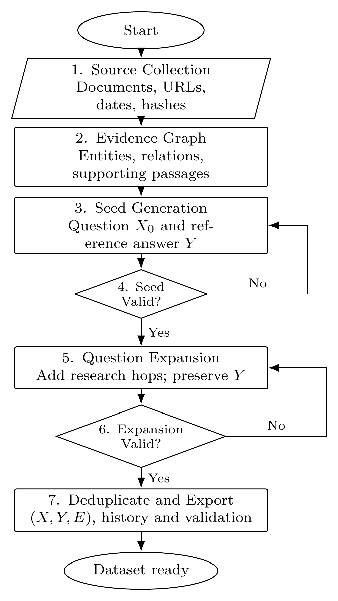

# Loop Research

Loop Research explores data and methods for deep-research systems. **Synthetic
Data Generation** is the first implemented stage, with company research as the
current example domain. Later project stages, including training and RL, are not
implemented.

## Synthetic Data Generation

<p align="center">
  <a href="docs/assets/synthetic-data-pipeline.png">
    
  </a>
</p>

We collect source evidence, build a structured evidence graph, and generate seed
questions with reference answers. We then expand each question's research
dependencies while preserving its answer, independently validate correctness
and solvability, revise or reject failed candidates, and deduplicate and export
the accepted dataset. The expansion method is inspired by
[WebShaper](https://arxiv.org/abs/2507.15061v1).

## Quickstart

Requires Python 3.11+ and `uv`; run from the repository root. This offline example
uses **fictional scripted fixtures**, with no model or search calls.

```bash
uv venv
uv pip install -r requirements.lock
export PYTHONPATH="$PWD/src"
.venv/bin/python -m webshaper run --config configs/fixture.json --run-dir runs/quickstart
```

Results appear in `runs/quickstart/export/`; repeat the run command to resume.
Live runs use Codex subscription authentication through ChatGPT sign-in, enforce
configured usage limits, and allow $0 additional paid API/search spend.

## Outputs

Each dataset includes **questions, reference answers, evidence, and validation
records**, with source snapshots and revision history retained for audit.
References and validation records remain separate from solver-visible inputs;
automatically accepted live tasks await human review.

## Documentation

- [Configuration, live runs, and authentication](docs/running.md)
- [Output files and human review](docs/outputs.md)
- [Testing and troubleshooting](docs/development.md)
- [Design and company-research adaptations](docs/design.md)
- [Recorded runs](docs/run-results.md) and [verification history](docs/verification-log.md)
- [Implementation plan](docs/implementation-plan.md) and [original brief](2026-10-17-webshaper-data-generation.md)
